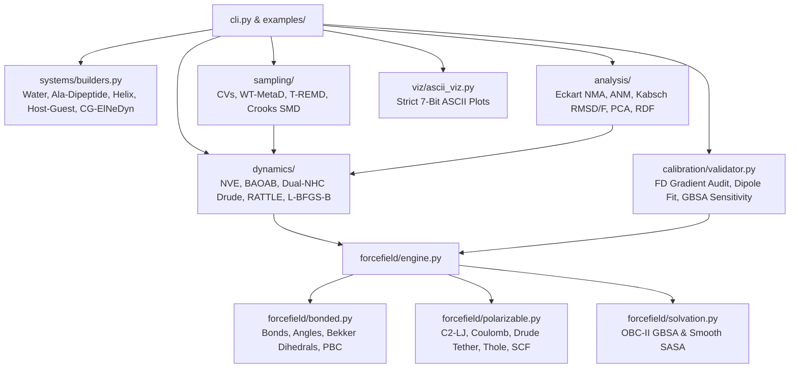
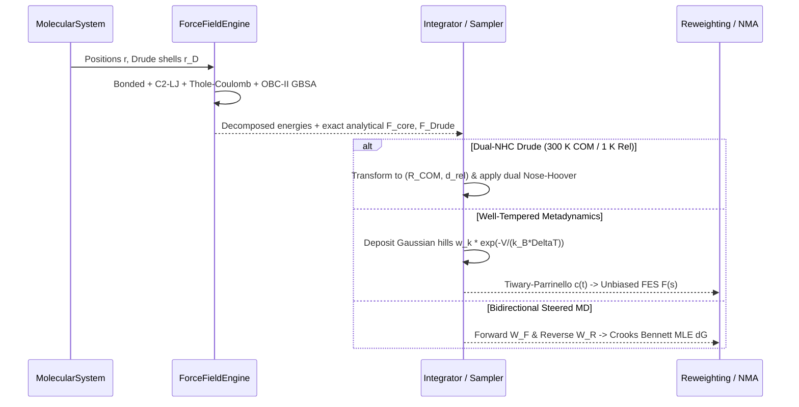

# SolvatoDyne

[](https://github.com/ZengLLQ/solvato-dyne/actions/workflows/ci.yml)
[](https://www.python.org/downloads/)
[](LICENSE)
[](#)

**SolvatoDyne** is a self-contained computational biophysics and molecular simulation engine implementing classical and Drude-polarizable force fields with Thole dipole screening, Onufriev-Bashford-Case (OBC-II) Generalized Born / smooth-SASA implicit solvation, coarse-grained ElNeDyn elastic networks, symplectic and dual-thermostat extended-Lagrangian integrators, and enhanced-sampling free-energy estimators (Temperature Replica-Exchange MD, Well-Tempered Metadynamics with Tiwary-Parrinello reweighting, bidirectional Steered MD with Crooks Fluctuation Theorem MLE, and Eckart-projected Normal Mode Analysis).

---

## Table of Contents

1. [Architecture & Module Dependency Map](#architecture--module-dependency-map)
2. [Mathematical & Physical Formulation](#mathematical--physical-formulation)
3. [Subsystem Breakdown & Invariants](#subsystem-breakdown--invariants)
4. [Installation & Quick Start](#installation--quick-start)
5. [CLI Reference (6 Operational Subcommands)](#cli-reference-6-operational-subcommands)
6. [Python SDK Walkthroughs](#python-sdk-walkthroughs)
7. [Verification, Gradient Audits & Numerical Convergence](#verification-gradient-audits--numerical-convergence)
8. [7-Bit ASCII Visualization Output](#7-bit-ascii-visualization-output)
9. [Architectural Trade-Offs & Known Limitations](#architectural-trade-offs--known-limitations)

---

## Architecture & Module Dependency Map



### Dual-Thermostat Drude & Enhanced-Sampling Execution Flow



---

## Mathematical & Physical Formulation

### 1. Bonded, Bekker Torsion & Coarse-Grained Potentials

Under orthorhombic or triclinic minimum-image periodic boundary conditions $\Delta \mathbf{r}_{ij} = \mathbf{r}_j - \mathbf{r}_i - \mathbf{H}\,\operatorname{round}(\mathbf{H}^{-1}(\mathbf{r}_j - \mathbf{r}_i))$:

$$U_{\text{bonded}} = \sum_{\text{bonds}} \frac{1}{2} k_b (r_{ij} - r_0)^2 + \sum_{\text{angles}} \frac{1}{2} k_\theta (\theta_{ijk} - \theta_0)^2 + \sum_{\text{dihedrals}} k_\phi [1 + \cos(n\phi - \delta)] + \sum_{\text{impropers}} \frac{1}{2} k_\omega \operatorname{wrap}(\omega - \omega_0)^2$$

Proper and improper torsions use the singularity-free Blondel-Karplus / Bekker vector formulation with $\mathbf{m} = \mathbf{b}_1 \times \mathbf{b}_2$, $\mathbf{n} = \mathbf{b}_2 \times \mathbf{b}_3$, and $\phi = \operatorname{atan2}\!\left(\hat{\mathbf{b}}_2 \cdot (\mathbf{m} \times \mathbf{n}),\; \mathbf{m}\cdot\mathbf{n}\right)$:

$$\nabla_{\mathbf{p}_0}\phi = -\frac{\|\mathbf{b}_2\|}{\|\mathbf{m}\|^2}\mathbf{m}, \qquad \nabla_{\mathbf{p}_3}\phi = \frac{\|\mathbf{b}_2\|}{\|\mathbf{n}\|^2}\mathbf{n}$$

with torque-conserving interior derivatives $\nabla_{\mathbf{p}_1}\phi$ and $\nabla_{\mathbf{p}_2}\phi$ satisfying $\sum_{k=0}^3 \nabla_{\mathbf{p}_k}\phi = \mathbf{0}$ and $\sum_{k=0}^3 \mathbf{p}_k \times \nabla_{\mathbf{p}_k}\phi = \mathbf{0}$.

### 2. Drude Induced-Dipole Polarization & Thole Screening

Each polarizable atom $i$ with isotropic polarizability $\alpha_i$ ($\text{\AA}^3$) and tether force constant $k_{D,i}$ carries an auxiliary Drude particle of mass $m_D = 0.4\text{ amu}$ and negative charge:

$$q_{D,i} = -\sqrt{\frac{k_{D,i}\,\alpha_i}{k_e}}, \qquad q_{\text{core},i} = q_i - q_{D,i}, \qquad k_e = 332.0637133\text{ kcal\cdot\AA\cdot mol}^{-1}e^{-2}$$

The Drude potential combines the harmonic core-shell tether, an optional quartic hyperpolarization wall guard above $r_{\text{wall}}$, and short-range Thole dipole-dipole screening:

$$U_{\text{Drude}} = \sum_{i \in \mathcal{P}} \left[\frac{1}{2} k_{D,i} d_i^2 + k_{\text{wall}} \max(0, d_i - r_{\text{wall}})^4\right]$$

$$S_{ij}(r) = 1 - \left(1 + \frac{u_{ij}}{2}\right) e^{-u_{ij}}, \qquad u_{ij} = \frac{(a_i + a_j)\,r}{2\,(\alpha_i \alpha_j)^{1/6}}$$

Pairwise Lennard-Jones 12-6 interactions apply a $C^2$-continuous quintic force switch $S_{\text{sw}}(x) = 1 - 10x^3 + 15x^4 - 6x^5$ across $[r_{\text{on}}, r_{\text{cut}}]$.

### 3. OBC-II Generalized Born & Smooth SASA Implicit Solvation

Effective Born radii $\alpha_i$ are computed via Hawkins-Cramer-Truhlar (HCT) pairwise sphere-descreening integrals $I_{ij}(r_{ij}, \rho_i, S_j \rho_j)$ ($\rho_i = R_i - 0.09\text{ \AA}$) and the Onufriev-Bashford-Case (OBC-II) rescaling:

$$\psi_i = \rho_i \sum_{j \neq i} I_{ij}, \qquad \frac{1}{\alpha_i} = \frac{1}{\rho_i} - \frac{1}{R_i}\tanh\!\left(1.0\,\psi_i - 0.8\,\psi_i^2 + 4.85\,\psi_i^3\right)$$

$$E_{\text{GB}} = -\frac{k_e}{2}\left(\frac{1}{\varepsilon_{\text{in}}} - \frac{1}{\varepsilon_{\text{out}}}\right)\sum_{i,j} \frac{q_i q_j}{\sqrt{r_{ij}^2 + \alpha_i \alpha_j \exp\!\left(-\frac{r_{ij}^2}{4\alpha_i \alpha_j}\right)}}$$

Full analytical chain-rule derivatives $-\frac{\partial E_{\text{GB}}}{\partial \alpha_k}\frac{\partial \alpha_k}{\partial \psi_k}\nabla \psi_k$ are evaluated alongside a $C^2$-smooth exponential-overlap SASA nonpolar cavitation term $E_{\text{SASA}} = \gamma_{\text{surf}} \sum_i S_i^{\max}\exp\!\left(-B_i(\mathbf{r}) / S_i^{\max}\right)$.

### 4. Dual-Thermostat Extended-Lagrangian Drude & BAOAB Integrators

Core and Drude coordinates are canonically transformed into atomic center-of-mass $(\mathbf{R}_i, \mathbf{V}_{\text{COM},i})$ and relative internal $(\mathbf{d}_i, \mathbf{v}_{\text{rel},i})$ variables with reduced mass $\mu_{D,i} = \frac{m_{c,i} m_{D,i}}{m_{c,i} + m_{D,i}}$:

$$\frac{1}{2}m_{c,i}\|\mathbf{v}_{c,i}\|^2 + \frac{1}{2}m_{D,i}\|\mathbf{v}_{D,i}\|^2 \equiv \frac{1}{2}M_i\|\mathbf{V}_{\text{COM},i}\|^2 + \frac{1}{2}\mu_{D,i}\|\mathbf{v}_{\text{rel},i}\|^2$$

Separate Nosé-Hoover thermostats maintain $T_{\text{COM}} = 300\text{ K}$ and cold internal Drude oscillators at $T_D = 1\text{ K}$, while holonomic H-bond constraints are enforced by RATTLE coordinate and orthogonal velocity projections ($\|\mathbf{r}_{ij}\| = d_0$, $\mathbf{r}_{ij}\cdot\mathbf{v}_{ij} = 0$).

### 5. Well-Tempered Metadynamics & Tiwary-Parrinello Reweighting

Gaussian hills along 1D/2D differentiable collective variables $\mathbf{s}(\mathbf{r})$ are rescaled by the bias factor $\gamma = (T + \Delta T)/T$:

$$w_k = w_0 \exp\!\left(-\frac{V(\mathbf{s}_k, t_k)}{k_B \Delta T}\right), \qquad F_{\text{direct}}(\mathbf{s}) = -\frac{\gamma}{\gamma - 1}V(\mathbf{s})$$

Unbiased Boltzmann statistics are recovered via the time-dependent Tiwary-Parrinello offset:

$$c(t) = k_B T \ln \frac{\sum_{\text{grid}} \exp\!\left(\frac{\beta \gamma}{\gamma - 1} V(\mathbf{s}, t)\right)}{\sum_{\text{grid}} \exp\!\left(\frac{\beta}{\gamma - 1} V(\mathbf{s}, t)\right)}, \qquad w_{\text{unbiased}}(t) \propto \exp\!\left(\frac{V(\mathbf{s}(t), t) - c(t)}{k_B T}\right)$$

### 6. T-REMD & Bidirectional Crooks Fluctuation Theorem MLE

Adjacent replicas $(i, j)$ swap coordinates and Maxwell-rescaled velocities $\mathbf{v}' = \sqrt{T_{\text{new}}/T_{\text{old}}}\mathbf{v}$ with exact detailed-balance acceptance $P(i \leftrightarrow j) = \min\!\left(1, \exp[(\beta_i - \beta_j)(U_j - U_i)]\right)$, plus Katzgraber-Trebst-Nadler feedback temperature ladder adaptation.

For non-equilibrium Steered MD pulls ($A \leftrightarrow B$), Jarzynski's equality and the exact Bennett / Crooks Fluctuation Theorem maximum-likelihood estimator solve:

$$\Delta G_{\text{Jarz}} = -k_B T \ln\left\langle e^{-\beta W_F}\right\rangle, \qquad \sum_{i=1}^{N_F}\frac{1}{1 + \frac{N_F}{N_R}e^{\beta(W_{F,i} - \Delta G)}} = \sum_{j=1}^{N_R}\frac{1}{1 + \frac{N_R}{N_F}e^{\beta(W_{R,j} + \Delta G)}}$$

### 7. Eckart-Projected Normal Mode Analysis & Quantum Harmonic Thermodynamics

The mass-weighted Hessian $\mathbf{H}_{\text{mw}} = \mathbf{M}^{-1/2}\mathbf{H}\mathbf{M}^{-1/2}$ is projected onto the $(3N-6)$-dimensional internal vibrational subspace via $\mathbf{P} = \mathbf{I} - \mathbf{Q}_{\text{Eckart}}\mathbf{Q}_{\text{Eckart}}^T$, yielding wavenumbers $\tilde{\nu}_k$ ($\text{cm}^{-1}$), zero-point energy $\sum_k \frac{1}{2} h c \tilde{\nu}_k$, harmonic entropy $S_{\text{vib}}$, Helmholtz energy $F_{\text{vib}}$, and Debye-Waller B-factors $B_i = \frac{8\pi^2}{3}\langle \Delta r_i^2 \rangle$.

---

## Subsystem Breakdown & Invariants

| Subsystem | Module(s) | Key Classes / Functions | Enforced Invariants |
| --- | --- | --- | --- |
| **Core Types & Units** | `solvato_dyne.types` | `AtomSpec`, `MolecularSystem`, `BoxSpec`, `EnergyBreakdown` | Charge & mass conservation ($q_c + q_D = q$, $m_c + m_D = m$); shape validation |
| **System Builders & PDB** | `solvato_dyne.systems.builders` | `build_polarizable_water_dimer_or_cluster`, `build_alanine_dipeptide_system`, `build_alpha_helix_peptide`, `build_host_guest_unbinding_system`, `map_all_atom_to_cg`, `parse_pdb_block` | Exact net charge neutrality; 1-2/1-3 exclusions & 1-4 pair separation |
| **Bonded & PBC** | `solvato_dyne.forcefield.bonded` | `compute_bonded_forces`, `dihedral_angle_and_grad`, `minimum_image_displacement` | $\sum \mathbf{F} = \mathbf{0}$, $\sum \mathbf{r}\times\mathbf{F} = \mathbf{0}$, branch-cut continuity |
| **Polarizable & Thole** | `solvato_dyne.forcefield.polarizable` | `compute_nonbonded_and_drude_forces`, `relax_drude_scf` | $C^2$ LJ switch continuity, quartic hyperpolarization guard, SCF residual $< 10^{-5}$ |
| **Implicit Solvation** | `solvato_dyne.forcefield.solvation` | `compute_gbsa_forces`, `_hct_integral_and_deriv` | Positive Born radii $\alpha_i > 0$, exact analytical chain rule vs FD $< 10^{-7}$ |
| **Dynamics & Constraints** | `solvato_dyne.dynamics.*` | `MDSimulator`, `DrudeDualThermostatIntegrator`, `BAOABIntegrator`, `VelocityVerletIntegrator`, `apply_rattle_positions` | RATTLE drift $< 10^{-8}\text{ \AA}$, COM+relative kinetic identity, extended Hamiltonian |
| **Enhanced Sampling** | `solvato_dyne.sampling.*` | `DistanceCV`, `RadiusOfGyrationCV`, `CoordinationNumberCV`, `DihedralCV`, `RMSDCV`, `WellTemperedMetadynamics`, `TemperatureReplicaExchange`, `SteeredMDSimulator`, `crooks_mle_free_energy` | Analytical CV gradients ($<10^{-5}$), bijection replica swaps, monotonic Bennett root |
| **Normal Modes & Trajectory** | `solvato_dyne.analysis.*` | `run_hessian_nma`, `run_anm_analysis`, `build_eckart_basis`, `kabsch_align`, `compute_pca_essential_dynamics`, `compute_radial_distribution` | Orthonormal Eckart basis ($\mathbf{Q}^T\mathbf{Q}=\mathbf{I}_6$), $SO(3)$ Kabsch invariance |
| **Calibration & ASCII Viz** | `solvato_dyne.calibration.validator`, `solvato_dyne.viz.ascii_viz` | `audit_forcefield_gradients`, `calibrate_drude_dipole_parameters`, `compute_gbsa_sensitivity`, `assert_ascii` | Strict 7-bit ASCII (`ord(c) <= 127`) across all CLI and visualization outputs |

---

## Installation & Quick Start

```bash
git clone https://github.com/ZengLLQ/solvato-dyne.git
cd solvato-dyne
python -m pip install -e ".[dev]"
pytest -v
```

---

## CLI Reference (6 Operational Subcommands)

Run via `solvato-dyne <subcommand>` or `python -m solvato_dyne.cli <subcommand>`:

| Subcommand | Purpose | Example |
| --- | --- | --- |
| `simulate` | Run NVE, BAOAB NVT, or dual-NHC Drude MD | `solvato-dyne simulate --system water-dimer --integrator drude --steps 200` |
| `remd` | Run Temperature Replica-Exchange MD & $C_v(T)$ | `solvato-dyne remd --system ala-dipeptide --replicas 4 --cycles 16` |
| `metad` | Run 1D/2D Well-Tempered Metadynamics & reweighting | `solvato-dyne metad --system ala-dipeptide --steps 250 --stride 20` |
| `steer` | Run bidirectional SMD & Crooks MLE $\Delta G$ | `solvato-dyne steer --system host-guest --n-paths 5 --steps 100` |
| `modes` | Run Eckart-projected Hessian NMA or ANM | `solvato-dyne modes --system ala-dipeptide --method hessian` |
| `calibrate` | Audit analytical gradients, fit dipoles, run GBSA UQ | `solvato-dyne calibrate` |

---

## Python SDK Walkthroughs

```python
from solvato_dyne import (
    build_alanine_dipeptide_system,
    DihedralCV,
    WellTemperedMetadynamics,
    run_hessian_nma,
)

ala = build_alanine_dipeptide_system(polarizable=True, use_gbsa=True)
phi = DihedralCV(1, 3, 5, 7, name="phi")
psi = DihedralCV(3, 5, 7, 9, name="psi")

metad = WellTemperedMetadynamics([phi, psi], sigmas=[0.35, 0.35], bias_factor=8.0)
fes_res = metad.run(ala, n_steps=250, save_every=15)
nma_res = run_hessian_nma(ala, temperature_k=300.0)
print(f"Final c(t): {fes_res.c_of_t[-1]:.3f} kcal/mol | ZPVE: {nma_res.zpve_kcal_mol:.3f} kcal/mol")
```

Standalone runnable workflows live in `examples/`:
- [`examples/01_drude_polarizable_water_and_dipole.py`](examples/01_drude_polarizable_water_and_dipole.py)
- [`examples/02_gbsa_alanine_dipeptide_metadynamics.py`](examples/02_gbsa_alanine_dipeptide_metadynamics.py)
- [`examples/03_tre_md_peptide_folding_and_nma.py`](examples/03_tre_md_peptide_folding_and_nma.py)
- [`examples/04_bidirectional_smd_crooks_unbinding.py`](examples/04_bidirectional_smd_crooks_unbinding.py)

---

## Verification, Gradient Audits & Numerical Convergence

All analytical force-field and collective-variable gradients are audited against central finite differences ($\varepsilon = 10^{-5}\text{ \AA}$):

| Potential Term | Max Absolute Error ($\text{kcal mol}^{-1}\text{\AA}^{-1}$) | RMS Relative Error | Status |
| --- | --- | --- | --- |
| Bonded (Bonds + Angles + Bekker Dihedrals + Impropers) | `4.55e-08` | `1.00e-10` | PASS |
| Non-bonded (C2-LJ + Coulomb + Drude Tether + Thole Core) | `5.28e-09` | `1.07e-10` | PASS |
| Drude Auxiliary Shells (Thole + Quartic Guard) | `5.99e-09` | `7.91e-11` | PASS |
| OBC-II Generalized Born + Smooth SASA | `6.87e-09` | `1.13e-09` | PASS |

---

## 7-Bit ASCII Visualization Output

```text
=== BIDIRECTIONAL STEERED MD & CROOKS MLE (pocket_ligand_A) ===
Paths: 5 fwd / 5 rev
Work Distribution (F = forward W_F, R = reverse -W_R):
     4.15 |            | RRR
     5.40 | F          | RR        <-- dG
     6.65 | FFF        |
     7.90 | F          |
```

---

## Architectural Trade-Offs & Known Limitations

- **Pure-Python / NumPy Pairwise Loops**: Non-bonded, Thole, and OBC-II GBSA evaluations use explicit pairwise loops optimized for clarity, exact analytical chain-rule verification, and zero native-extension build failures across Linux/macOS/Windows CI; large periodic systems ($N > 10^3$) are slower than GPU-accelerated C++/CUDA engines such as OpenMM or GROMACS.
- **Built-in Force-Field Benchmarks**: Built-in molecules (SWM4-inspired Drude water, capped alanine dipeptide, alpha-helix, host-guest complex, CG ElNeDyn) carry self-contained pedagogical/benchmark parameters; arbitrary PDB imports assign generic element-based LJ/GBSA parameters unless customized.
- **Research Scope**: Intended solely for computational biophysics research, algorithm validation, and simulation benchmarking.
